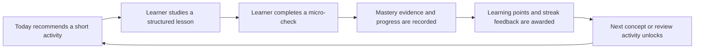
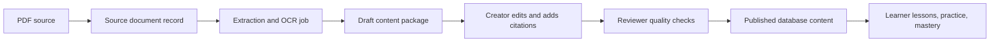

# Mathios Product and Engineering Plan

## Recommended direction

Build Mathios as a learning platform with books as source material—not as a PDF library.

The correct model is hybrid:

- PDFs are immutable source documents stored in object storage.
- Markdown and JSON are version-controlled content packages.
- The database stores published courses, lessons, concepts, questions, mastery, progress, and rewards.
- Content creators import and edit content through a protected workflow.
- Administrators manage users, permissions, storage, backups, and system settings.
- Learners interact with structured lessons, practice, mastery, and light gamification.

You should not manually add 70 books through a superadmin account.

## Current repository status

The repository already contains much of the application foundation:

- Curriculum, subjects, courses, modules, lessons, concepts, exercises, assessments, roadmaps, simulations, laboratories, notes, analytics, classrooms, AI authoring, storage, portability, and mastery.
- A modular-monolith architecture with explicit repositories for SQLite/Postgres in [ARCHITECTURE.md](../ARCHITECTURE.md).
- Existing authoring and publishing workflows described in [phase3-content-authoring.md](phase3-content-authoring.md).
- Existing learning points, streaks, recommendations, and daily learning activity.
- Existing PDF/storage plumbing, but the lesson editor currently relies mostly on manual source URLs and the lesson reader does not yet provide a complete PDF/document experience.
- Existing AI content generation, but it is correctly designed to produce reviewable drafts rather than automatically published content.

The current quality baseline is:

- Production build: passed.
- TypeScript: passed.
- ESLint: passed.
- Unit tests: 60 files and 122 tests passed.
- Formatting: four existing files currently fail Prettier checks.
- End-to-end testing exists, but the new PDF-import and gamification journeys still need to be added.

The first engineering task should be fixing the formatting baseline in:

- `src/app/learn/page.tsx`
- `src/app/page.tsx`
- `src/components/layout/sidebar.tsx`
- `src/features/settings/actions.ts`

## Product loop

The main experience should be:



A typical 10–15 minute session:

1. The learner opens Today.
2. Mathios recommends one specific activity and explains why.
3. The learner studies a short lesson made from the source material.
4. The lesson includes diagrams, formulas, examples, and a small interaction.
5. The learner answers one or more questions.
6. The system gives immediate feedback and records mastery evidence.
7. The learner receives modest points, streak progress, or a milestone.
8. The next appropriate concept or review task becomes available.

The important separation is:

- Completion means the learner reached or finished content.
- Mastery means the learner demonstrated understanding.
- Gamification is motivation only and must never replace mastery evidence.

## Gamification strategy

The app should feel rewarding, not childish or addictive.

### Keep for version one

- Daily learning goal.
- Study streak.
- Learning points.
- Small completion animation.
- Daily missions such as:
  - Complete one lesson.
  - Answer three practice questions.
  - Review one weak concept.
  - Finish one short study session.
- Milestones such as:
  - First completed lesson.
  - First mastered concept.
  - Completed a subject route.
  - Seven consistent study days.
- Clear progress toward the next concept or roadmap milestone.

### Avoid initially

- Public leaderboards.
- Competitive rankings.
- Loot boxes.
- Virtual currency.
- Punishing users for missing a day.
- Excessive confetti, sounds, timers, or fake urgency.
- Awarding points repeatedly for endlessly retrying the same question.

### Reward architecture

The current `learningPoints` and `studyStreak` implementation should be formalized into a server-authoritative reward system.

Recommended entities:

- `learning_reward_events`
  - profile ID
  - reward type
  - points
  - source event
  - source ID
  - deduplication key
  - timestamp
  - metadata
- `reward_definitions`
  - lesson completion
  - correct answer
  - study session
  - assessment completion
  - roadmap milestone
- `profile_rewards`
- `achievement_definitions`
- `profile_achievements`
- Optional later:
  - `quests`
  - `profile_quests`

Every reward must be idempotent. If a request is retried, the learner must not receive the same reward twice.

The current rules can be a reasonable starting point:

- Lesson completion: 20 points.
- Correct question: 5 points.
- Completed study session: 10 points.

These should eventually become configurable reward definitions rather than hardcoded service logic.

Learners should be able to hide or reduce gamification in settings.

## Content workflow: PDFs, Markdown, JSON, and the database

The recommended content lifecycle is:



### What belongs where

| Content | Storage |
|---|---|
| PDF books | Object storage |
| PDF metadata | Database |
| Extracted page text | Database or indexed storage |
| Lesson prose | Markdown or structured JSON |
| Concepts and relationships | JSON/database |
| Questions and answers | JSON/database |
| Roadmaps | JSON/database |
| Published lessons | Database |
| Source citations | Database |
| Progress and mastery | Database |
| Analytics events | Database |

Do not put large PDFs inside Git.

Do not make the PDF itself the lesson.

Do not make production database edits the normal authoring process.

### Content source of truth

Use this model:

- The original PDF is the immutable source artifact.
- The Markdown/JSON package is the versioned authoring/import artifact.
- The database is the runtime source of truth for published content.
- Every published record stores its package version and source citations.

This gives reproducible imports without preventing editors from working through the application.

## Recommended authoring roles

The current project has `learner`, `teacher`, `content-creator`, and `administrator` roles. That is already enough to begin.

### Learner

- View published content.
- Complete lessons.
- Practice.
- Create personal notes.
- View own progress and mastery.

### Content creator

- Upload source documents.
- Start extraction jobs.
- Create and edit draft courses.
- Create concepts, exercises, and assessments.
- Add citations.
- Preview content.

### Content reviewer

This can initially be a permission set rather than a new role.

- Review scientific accuracy.
- Review source attribution.
- Review age/level suitability.
- Review accessibility.
- Review exercises and answer keys.
- Approve or reject drafts.

### Publisher

- Publish approved content.
- Deprecate or replace published versions.
- Cannot modify system permissions unless also an administrator.

### Administrator

- Manage roles and permissions.
- Manage system settings.
- Manage backups and storage.
- View audit logs.
- Perform emergency overrides.

A “superadmin” should not be the normal content-entry mechanism. If one person owns the system initially, they can temporarily have administrator and content-publisher permissions, but the architecture should not depend on that.

## PDF ingestion pipeline

The ingestion system should be a durable, resumable workflow.

### Step 1: Inventory the 70 PDFs

Create an inventory before importing anything:

- Filename.
- Title.
- Author.
- Edition.
- Publisher.
- Year.
- ISBN if available.
- Subject.
- Intended age/grade.
- Language.
- File size.
- Page count.
- SHA-256 checksum.
- License or rights status.
- Source location.
- Priority.
- Import status.
- Reviewer.
- Notes.

This inventory can initially be a CSV or spreadsheet. The `spreadsheets:Spreadsheets` skill or optional Airtable/Google Sheets connector can help manage it.

### Step 2: Upload and quarantine

When a creator uploads a PDF:

1. Verify the user has content-upload permission.
2. Create an ingestion job.
3. Issue a short-lived upload token tied to that job.
4. Upload into quarantine storage.
5. Validate file size and MIME type.
6. Check PDF magic bytes rather than trusting the extension.
7. Calculate a checksum.
8. Scan for malware if deployed publicly.
9. Store the file privately.
10. Record metadata and status.

The existing storage system is useful, but new book uploads should not rely only on a generic authenticated signed-URL endpoint. Upload authorization should be bound to the content role and ingestion job.

### Step 3: Extract and inspect

Use:

- `pypdf` for basic metadata and page operations.
- `pdfplumber` for text and layout extraction.
- `ocrmypdf` and Tesseract for scanned documents.
- Poppler `pdftoppm` for rendering pages.
- `sharp` for thumbnails if needed.
- `file-type` for file signature detection.

The PDF extraction process must preserve:

- Page boundaries.
- Chapter headings.
- Section headings.
- Figure references.
- Table boundaries where possible.
- Formula text.
- Source page numbers.
- OCR confidence.
- Extraction method.

Render sample pages for visual quality assurance. Successful text extraction does not mean diagrams, formulas, or multi-column layouts were extracted correctly.

### Step 4: Create draft learning content

The importer should suggest:

- Chapters.
- Topics.
- Concepts.
- Prerequisites.
- Lesson boundaries.
- Examples.
- Misconceptions.
- Practice questions.
- Assessment questions.
- Source citations.

AI may assist with this, but every generated item must remain a draft.

AI must never:

- Automatically publish.
- Invent uncited scientific claims.
- Replace the original source.
- Treat PDF instructions as system instructions.
- Be trusted with arbitrary tool execution.

### Step 5: Review and publish

The content creator sees:

- Extracted source pages.
- Proposed lesson structure.
- Generated Markdown/JSON.
- Page citations.
- Validation warnings.
- Missing prerequisites.
- Missing answer explanations.
- Formula or unit warnings.
- Accessibility warnings.

The reviewer approves each package before publication.

## Content package format

Use a predictable package structure:

```text
content/
  packages/
    microbiology-foundations/
      manifest.json
      sources.json
      concepts.json
      lessons/
        01-cell-structure.md
        02-cell-membranes.md
      questions.json
      assessments.json
      roadmap.json
      citations.json
```

### `manifest.json`

Should contain:

- Package ID.
- Package version.
- Subject.
- Language.
- Intended level.
- Importer version.
- Source document IDs.
- Content status.
- Stable slugs.
- Checksums.
- Created and reviewed metadata.

### Markdown

Use Markdown for:

- Lesson explanations.
- Examples.
- Summaries.
- Misconceptions.
- Explanatory prose.

### JSON

Use JSON for:

- Concepts.
- Prerequisites.
- Questions.
- Answer keys.
- Assessment configuration.
- Roadmaps.
- Citations.
- Structured blocks.

Validate every package with Zod before importing.

If the app needs real Markdown rendering, add a controlled pipeline using:

- `react-markdown`
- `remark-gfm`
- `remark-math`
- `rehype-katex`
- `rehype-sanitize`

Never render arbitrary HTML from source documents without sanitization and an allowlist.

## Example content transformation

One microbiology chapter should not become one giant PDF lesson.

It might become:

- Module: Foundations of Microbiology.
- Lesson 1: What makes an organism microbial?
- Lesson 2: Prokaryotic and eukaryotic cells.
- Lesson 3: Cell walls and membranes.
- Lesson 4: Binary fission and growth.
- Lesson 5: Gram staining and interpretation.
- Concepts:
  - Cell membrane.
  - Cell wall.
  - Ribosome.
  - Plasmid.
  - Binary fission.
  - Gram-positive.
  - Gram-negative.
- Practice:
  - Identify a structure.
  - Compare two organisms.
  - Interpret a staining result.
  - Correct a misconception.
- Checkpoint:
  - Explain the relationship between structure and function.
- Sources:
  - Exact book and page citations.

The same pattern works for physics, chemistry, mathematics, and astronomy.

## Recommended database additions

Reuse the existing curriculum, course, lesson, concept, exercise, assessment, roadmap, analytics, and storage tables.

### Source documents

`source_documents`

- Stable ID.
- Title.
- Authors.
- Edition.
- Publisher.
- Year.
- ISBN.
- Language.
- Subject.
- Level.
- Rights status.
- Rights notes.
- Storage key.
- MIME type.
- Byte size.
- SHA-256.
- Page count.
- Extraction method.
- Processing status.
- Created by.
- Timestamps.

### Source pages

`source_document_pages`

- Document ID.
- Page number.
- Extracted text.
- OCR confidence.
- Rendered image key.
- Heading markers.
- Processing warnings.

### Source chunks

`source_chunks`

- Document ID.
- Page range.
- Section title.
- Chunk text.
- Token count.
- Content hash.
- Optional embedding.

### Citations

Use a typed citation table or typed link records connecting:

- Lessons to source pages.
- Concepts to source pages.
- Questions to source pages.
- Assessments to source pages.
- Figures to source pages.

A citation should include:

- Source document ID.
- Page start and end.
- Citation text.
- Optional author/editor note.

### Import jobs

`content_import_jobs`

- Job ID.
- Package ID.
- Status.
- Progress.
- Importer version.
- Idempotency key.
- Error details.
- Started/finished timestamps.
- Initiating user.

`content_import_items`

- Job ID.
- Entity type.
- Stable entity key.
- Draft/published state.
- Validation status.
- Error details.

### Quality reviews

`content_quality_reviews`

- Scientific accuracy.
- Source attribution.
- Reading level.
- Accessibility.
- Formula and unit validation.
- Exercise validity.
- Safety review.
- AI-generated-content review.
- Reviewer.
- Decision.
- Decision notes.

## UX plan

### Learner surfaces

#### Today

- Daily learning goal.
- Streak.
- Learning points.
- Recommended activity.
- Why the activity was recommended.
- Resume card.
- Weak-concept review.
- Next roadmap milestone.

#### Lesson player

- Progress rail.
- Short sections instead of long scrolling walls of text.
- Diagrams and formulas.
- “Why this matters” context.
- Inline micro-checks.
- Hints.
- Explanations after incorrect answers.
- Source citation drawer.
- Save note/highlight.
- Related concepts.
- Completion recap.
- Next recommended activity.

#### Practice

- Adaptive review.
- Retry with a changed example.
- Spaced repetition later.
- Clear distinction between practice and assessment.

#### Mastery

- Concept map.
- Developing concepts.
- Needs-review concepts.
- Mastered concepts.
- Prerequisites.
- Evidence behind the mastery state.

#### Roadmaps

- Visible path.
- Locked nodes.
- Clear explanation for every lock.
- Optional personalized route.
- Progress milestones.

#### Progress

- Learning points.
- Streak.
- Lessons completed.
- Concepts introduced/practiced/mastered.
- Achievements.
- Weekly reflection.
- Gamification visibility settings.

### Authoring surfaces

Add to the existing authoring system:

- Source document library.
- PDF upload.
- Processing status.
- Extraction preview.
- Page image preview.
- Chapter/topic selector.
- Package import.
- Citation editor.
- Draft preview.
- Validation panel.
- Review queue.
- Publish checklist.
- Version history.
- Import retry/resume controls.

The existing `/content-studio`, course editor, lesson editor, question importer, assessment editor, and roadmap editor should become parts of this workflow rather than separate disconnected tools.

### Design direction

Use a calm “scientific field notebook / observatory” identity:

- Editorial typography.
- Dark ink or warm neutral surfaces.
- One or two strong accent colors.
- Diagrams and structured cards.
- Quiet progress indicators.
- Subtle motion on completion and unlocking.
- No generic dashboard full of identical cards.
- No excessive neon, gradients, or cartoon reward effects.

Continue using the existing Tailwind, shadcn/Radix, Lucide, Motion, and KaTeX stack. Do not rewrite the frontend framework.

Accessibility requirements:

- Keyboard navigation.
- Visible focus states.
- Screen-reader labels.
- Minimum 44px touch targets.
- No color-only status indicators.
- Reduced-motion support.
- Readable contrast.
- Clear loading, empty, error, and success states.
- Accessible formula alternatives where possible.

Playwright's official guidance recommends combining automated accessibility checks using `@axe-core/playwright` with manual accessibility review; automated scans cannot catch every accessibility problem. See [Playwright accessibility testing](https://playwright.dev/docs/accessibility-testing).

## Technical architecture

Keep the current modular monolith.

Recommended boundaries:

```text
src/
  app/                    Next routes and pages
  components/             Shared UI
  features/
    content-ingestion/
    content-authoring/
    gamification/
    mastery/
    exercises/
    search/
  domain/
    content/
    sources/
    rewards/
    mastery/
  infrastructure/
    database/
    storage/
    jobs/
    observability/
  server/
    auth/
    permissions/
    validation/
```

Use:

- Next App Router.
- React Server Components where appropriate.
- Client components only for interaction.
- Domain services independent of Next.
- Repository interfaces.
- SQLite and Postgres implementations.
- Zod validation at every boundary.
- Typed domain errors.
- Explicit transactions.
- Idempotency keys.
- Audit events.

The repository instructions specifically require reading the local Next documentation under `node_modules/next/dist/docs/` before implementing changes. The current official App Router documentation also reflects the modern Server Component and Server Function model. See [Next.js App Router documentation](https://nextjs.org/docs/app).

Do not introduce microservices yet. The content pipeline should first be a modular subsystem inside the existing application.

## Background jobs

PDF extraction, OCR, thumbnails, embeddings, and large imports must not run inside a normal request.

Start with:

- A local CLI worker.
- Database-backed job records.
- Resumable steps.
- Progress reporting.
- Retry and cancellation.
- Idempotent operations.

For hosted scale, choose one queue/workflow solution:

- Inngest.
- Trigger.dev.
- BullMQ with Redis.
- Cloudflare Queues.

Do not add multiple job systems.

Inngest is a reasonable option for this architecture because its functions support retriable background work, scheduled jobs, and checkpointed multi-step workflows. See [Inngest Functions](https://www.inngest.com/docs/learn/inngest-functions).

## Search and AI

### Search version one

Start with existing database search:

- SQLite FTS5 locally.
- Postgres full-text search in production.
- Search titles, concepts, lessons, questions, and extracted source chunks.
- Always show page citations for source results.

### Search version two

Only add embeddings after normal search is working:

- `pgvector` with Postgres.
- Hosted embeddings.
- Local embeddings with Transformers.js if privacy is important.

### AI version one

Use AI for:

- Lesson outlines.
- Concept suggestions.
- Question drafts.
- Misconception suggestions.
- Reading-level adaptation.
- Citation-aware summaries.

AI output should be:

- Labeled as generated.
- Stored as a draft.
- Linked to source pages.
- Reviewed before publication.
- Logged with provider/model/version.

The existing AI design described in [phase16-optional-ai.md](phase16-optional-ai.md) is directionally correct.

## Security and legal requirements

The 70 PDFs may not all be legally redistributable.

Before importing:

- Record license or permission status.
- Record source and attribution requirements.
- Keep private copyrighted material private.
- Do not expose raw PDF URLs publicly.
- Do not publish extracted book text as a replacement for the book.
- Prefer public-domain, openly licensed, or permissioned material for the first pilot.

PDF handling must include:

- Private object storage.
- Short-lived signed download URLs.
- Magic-byte validation.
- Size limits.
- SHA-256 checksums.
- Malware scanning.
- Path traversal protection.
- Safe filename normalization.
- SSRF prevention for remote imports.
- Sandboxed parsing/OCR.
- Backup retention policy.
- Audit logging.

Content security must include:

- Sanitized Markdown and HTML.
- Safe formula rendering.
- Link allowlists.
- Escaped PDF-derived text.
- No arbitrary script execution.
- No PDF text treated as system instructions.
- Server-only AI API keys.
- Rate limits on uploads, imports, AI, and answer submissions.

Use least privilege:

- A learner cannot access draft content.
- A content creator cannot modify user roles.
- A reviewer cannot alter audit history.
- An administrator cannot silently rewrite published content without an audit record.

## Testing strategy

No serious product can be guaranteed literally bug-free. The goal should be predictable, testable, observable, and reversible behavior.

### Unit tests

Test:

- Package schema validation.
- Stable content IDs.
- Import idempotence.
- Duplicate source detection.
- Chapter splitting.
- Citation validation.
- Prerequisite graph cycles.
- Reward deduplication.
- Streak calculations across time zones.
- Daily reward caps.
- Unlock rules.
- Mastery independence from points.
- PDF size and magic-byte validation.
- Answer tolerance for math and science questions.

### Integration tests

Run against SQLite and Postgres:

- Migrations.
- Repositories.
- Transactions.
- Import rollback.
- Partial job recovery.
- Storage adapters.
- Signed URL expiry.
- Backup and restore.
- Published-version replacement.

### API tests

Test:

- Authentication.
- Role permissions.
- Upload authorization.
- Import job ownership.
- Rate limits.
- Idempotency.
- Validation failures.
- Consistent error responses.
- AI provider failures.
- Concurrent completion submissions.

### Component tests

Add Testing Library where needed:

- Lesson player.
- PDF source panel.
- Reward notification.
- Daily mission.
- Import status panel.
- Review checklist.
- Locked roadmap node.
- Empty/loading/error states.

### End-to-end tests

The most important flow is:

1. Content creator signs in.
2. Uploads an openly licensed sample PDF.
3. Starts ingestion.
4. Reviews extracted pages.
5. Imports a draft package.
6. Adds or edits citations.
7. Publishes a lesson.
8. Learner signs in.
9. Learner finds the lesson.
10. Learner completes a micro-check.
11. Points and streak update exactly once.
12. Mastery evidence is recorded separately.
13. A roadmap node unlocks only when its real prerequisite is satisfied.
14. Learner resumes later.

Also test:

- Mobile layout.
- Desktop layout.
- Keyboard-only use.
- Reduced-motion mode.
- Permission denial.
- Failed upload.
- Failed OCR.
- Retry/resume.
- Duplicate import.
- Restore from backup.

### Property and visual tests

Optional but valuable:

- `fast-check` for prerequisite graphs and reward idempotence.
- Playwright screenshot regression tests.
- `@axe-core/playwright`.
- Lighthouse CI.
- k6 or Artillery for API load tests.
- Bundle-size budgets.
- PDF import duration and memory profiling.

CI should require:

```text
npm.cmd run format:check
npm.cmd run lint
npm.cmd run typecheck
npm.cmd test -- --coverage
npm.cmd run build
npm.cmd run test:e2e
```

Also add:

- SQLite migration smoke test.
- Postgres migration smoke test.
- Content package validation.
- Accessibility checks.
- Security scan.
- No critical or high-severity unresolved findings.

## Observability and operations

Keep the existing health, readiness, metrics, activity events, and analytics architecture described in [phase14-analytics.md](phase14-analytics.md).

Add metrics for:

- Upload successes/failures.
- OCR failures.
- Extraction duration.
- Pages processed.
- Job retry count.
- Queue depth.
- Import completion rate.
- Draft-to-published conversion.
- Citation coverage.
- Content review failures.
- Reward duplication attempts.
- Learner activation.
- First lesson completion.
- Practice accuracy.
- Mastery improvement.
- Streak retention.

Optional tools:

- Sentry for production errors and traces.
- PostHog for product analytics and feature flags.
- OpenTelemetry for deeper distributed tracing.
- Vercel logs and previews if deployed on Vercel.

Do not send raw PDF content or unnecessary personal data to analytics platforms.

## Deployment recommendation

For the current Next application, use one coherent deployment path.

### Simpler hosted path

- Vercel for the Next application.
- Neon Postgres.
- S3-compatible storage or Cloudflare R2.
- Inngest, Trigger.dev, or one queue provider.
- Sentry.
- Optional PostHog.

### Cloudflare-oriented path

- Cloudflare Pages/Workers or OpenNext.
- R2 for documents.
- Queues for ingestion.
- Turnstile for abuse protection.
- Postgres elsewhere if needed.

Do not combine Vercel, Cloudflare, Supabase, Neon, multiple queues, and multiple analytics vendors without a clear reason.

The current repository already supports SQLite/Postgres and local/hosted storage, so local development can remain:

- SQLite.
- Local storage.
- Local PDF fixtures.
- Optional Ollama.

Production can use:

- Postgres.
- Private object storage.
- Background workers.
- Backups.
- Monitoring.

## Phased implementation plan

### Phase 0: Product and architecture decisions

Deliver:

- Product brief.
- Target learner age/level.
- Supported languages.
- Subject taxonomy.
- Rights policy.
- Gamification policy.
- Content package schema.
- Source citation policy.
- ADRs for storage, jobs, search, and AI.
- Prettier baseline fix.
- CI quality gates.

Exit condition: the repository is green and the content contract is agreed upon.

### Phase 1: Source library and ingestion foundation

Deliver:

- PDF inventory.
- `source_documents`.
- `source_document_pages`.
- `content_import_jobs`.
- Secure upload flow.
- Quarantine storage.
- Metadata extraction.
- Page rendering.
- OCR fallback.
- Import status UI.
- Local ingestion CLI.
- Retry/resume/idempotence.

Exit condition: one sample PDF can be safely uploaded, processed, inspected, and resumed after failure.

### Phase 2: First pilot course

Choose one chapter from one openly licensed or permissioned book.

Deliver:

- Three to five lessons.
- Concepts and prerequisites.
- Practice questions.
- One checkpoint assessment.
- Roadmap placement.
- Page-level citations.
- Reviewer checklist.
- Published course version.

Exit condition: a learner can complete a complete, sourced learning path without opening a raw PDF.

### Phase 3: Gamification version one

Deliver:

- Reward ledger.
- Idempotent point rules.
- Streak logic based on learner timezone.
- Daily missions.
- Completion feedback.
- First milestone achievements.
- Gamification settings.
- Analytics for reward events.

Exit condition: rewards feel useful and modest, cannot be farmed, and never alter mastery calculations.

### Phase 4: Learner experience polish

Deliver:

- Strong lesson player.
- Source citation drawer.
- Inline checks.
- Improved practice flow.
- Better roadmap unlock states.
- Mastery explanations.
- Mobile and accessibility improvements.
- Reduced-motion behavior.
- Empty/loading/error states.

Exit condition: a new learner can finish a first session without confusion.

### Phase 5: Author and reviewer cockpit

Deliver:

- PDF library.
- Import package upload.
- Extraction preview.
- Citation editor.
- Validation dashboard.
- Review queue.
- Publish gate.
- Version history.
- Audit log.
- Batch import status.

Exit condition: content creators can process content without database access or administrator intervention.

### Phase 6: Search and grounded AI

Deliver:

- Full-text source search.
- Page citations.
- Optional semantic search.
- AI outline/question suggestions.
- AI draft review.
- Prompt-injection defenses.
- Provider failure handling.
- AI usage metrics.

Exit condition: search works without AI, and AI never bypasses review.

### Phase 7: Scale from one book to 70

Process in batches:

1. Microbiology.
2. Chemistry.
3. Physics.
4. Mathematics.
5. Astronomy.
6. Biology and related subjects.

For every batch:

- Deduplicate concepts.
- Normalize terminology.
- Validate prerequisites.
- Track source rights.
- Review citations.
- Measure processing time.
- Measure reviewer effort.
- Measure learner outcomes.

Do not import all 70 books before validating the first pilot.

### Phase 8: Production hardening

Deliver:

- Postgres production migration.
- Object-storage migration.
- Durable jobs.
- Backups.
- Restore drills.
- Sentry.
- Optional PostHog.
- Security review.
- Load tests.
- Accessibility review.
- Performance budgets.
- Rollback plan.
- Release checklist.

## First ten engineering tickets

1. Fix the four Prettier failures.
2. Write the product, rights, and gamification ADRs.
3. Define and validate the content package schema.
4. Add source-document and import-job database migrations.
5. Add secure role-bound PDF upload.
6. Add extraction/OCR/page-rendering CLI.
7. Add source citations and review checklists.
8. Import one pilot chapter into a draft course.
9. Add the reward ledger and idempotent points.
10. Add the complete author-to-learner Playwright journey with accessibility checks.

## Skills and plugins to use

### High-priority skills

- `nodejs-backend-patterns`
- `frontend-design`
- `ui-ux-pro-max`
- `redesign-existing-projects`
- `pdf:pdf`
- `vercel:nextjs`
- `vercel:react-best-practices`
- `vercel:verification`
- `vercel:agent-browser-verify`
- `github:github`
- `github:gh-fix-ci`
- `github:gh-address-comments`
- `codex-security:security-scan`
- `codex-security:deep-security-scan`
- `codex-security:validation`
- `codex-security:fix-finding`
- `neon-postgres`
- `neon-postgres-egress-optimizer`
- `spreadsheets:Spreadsheets`
- `web-perf`
- `openai-docs`
- `vercel:ai-sdk`

Use the threat-model skill when creating a formal threat-model document, not as a substitute for normal security review.

### Optional plugins worth installing selectively

- GitHub: repository, issue, PR, and CI workflows.
- Sentry: production monitoring.
- PostHog: product analytics and feature flags.
- Neon Postgres: database branching and operational workflows.
- Cloudflare: R2, Queues, Turnstile, or Cloudflare deployment.
- OpenAI Developers: official AI API documentation.
- Figma: design-system collaboration and handoff.
- Linear, Notion, or Asana: choose one for project tracking.
- Airtable or Google Sheets: choose one for the 70-book content inventory.
- Zotero: useful if source metadata and citations are managed there.
- HyperFrames or Remotion: optional animated science explainers, not core infrastructure.

Do not install every available plugin. Avoid adding Stripe, CRM, sales, or social tools until the product actually needs them.

### Currently useful MCPs and tools

- shadcn registry search for component discovery.
- shadcn examples for implementation patterns.
- shadcn audit checklist for UI quality.
- Node REPL for runtime and browser checks.
- Codex workspace dependency loader for the bundled Node/Python/PDF tooling.
- Web tools for current official documentation.
- Image generation for reviewed scientific illustrations and decorative assets.
- Browser/Playwright verification tools for actual user journeys.

These tools help build and verify the product; they are not production dependencies.

## Definition of done

The first real release is complete when:

### Learner

- Can select a subject.
- Can receive a recommended activity.
- Can complete a structured lesson.
- Can answer a practice question.
- Receives useful feedback.
- Sees points and streak progress.
- Has mastery evidence recorded.
- Can see why something unlocked or remains locked.
- Can resume later.
- Can hide gamification.

### Content team

- Can upload a permitted PDF.
- Can inspect extracted content.
- Can retry failed ingestion.
- Can import Markdown/JSON.
- Can edit lessons and questions.
- Can add page citations.
- Can run validation.
- Can review content.
- Can publish a version.
- Can roll back or deprecate a version.

### System

- Keeps PDFs private by default.
- Enforces permissions.
- Records audit events.
- Prevents duplicate imports and reward grants.
- Supports backups and restore.
- Handles OCR and extraction failures.
- Has production monitoring.
- Has a clear rollback process.

### Quality

- Formatting, lint, types, unit tests, build, and E2E pass.
- SQLite and Postgres migrations pass.
- Accessibility checks pass.
- Critical security findings are resolved.
- Performance budgets are defined.
- One complete author-to-learner workflow is automated.

## Final recommendation

Build one complete, polished, sourced pilot course first. Once the loop works—from PDF upload to authored lesson to learner mastery and light rewards—the remaining books become a repeatable content operation instead of 70 one-off engineering projects.
